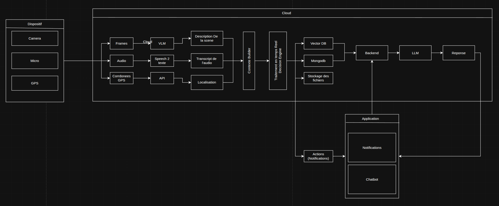

# Personal Assistant PIN

**A multimodal, event-driven personal assistant that turns everyday signals into useful, explainable support.**

Personal Assistant PIN brings together a streaming context pipeline, a deterministic decision engine, long-term memory, conversational interfaces, and a mobile experience. It is designed to combine signals such as images, audio, and location, then surface relevant reminders and context-aware answers.



## What this project demonstrates

- **Streaming data engineering:** Kafka topics and Spark Structured Streaming connect context ingestion to downstream processing.
- **Multimodal context processing:** separate audio, video, and location producers feed a context builder that creates normalized events.
- **LLM integration with controlled actions:** the LLM interprets context; deterministic rules and backend state produce decisions and notifications.
- **Persistent and semantic memory:** MongoDB stores auditable events and decisions, while Chroma supports vector retrieval.
- **Application development:** a React Native / Expo mobile experience and supporting chat interfaces connect users to assistant features.
- **Resilient service design:** validation, significance filtering, fallback interpretation, anti-spam rules, and unit tests address noisy input and service failures.

## Architecture

```text
Audio / video / location
          │
          ▼
  Kafka ingestion topics
          │
          ▼
 Spark context builder ──► normalized-context
                                  │
                                  ▼
                      Decision Engine (Spark)
                      validate → interpret →
                      update state → apply rules
                         │          │
                         ▼          ▼
                  MongoDB / Chroma  decision.actions
                         │          │
                         └────┬─────┘
                              ▼
                     Chat and mobile app
```

The decision engine keeps interpretation and action selection separate. Groq is used to extract structured meaning from significant context; backend modules apply rules, update user state, persist decisions, and publish selected actions.

## Key components

| Area | Implementation |
| --- | --- |
| Context ingestion | Audio, video, and location producers; Kafka publishing; Spark context builder |
| Decision engine | Python pipeline for validation, significance detection, state, meetings, rules, and decision construction |
| LLM layer | Groq client with a mockable interface and fallback handling |
| Storage and memory | MongoDB repositories and Chroma vector memory |
| Mobile app | Expo Router / React Native app in `KARAMO/mobile` |
| Supporting interfaces | Chat and tool-calling memory agent prototypes in `said/` and `tool-calling-memory-agent/` |

## Technology

**Python · Apache Kafka · Apache Spark · MongoDB · ChromaDB · Groq · Pydantic · Docker Compose · React Native · Expo · TypeScript**

## Run the local data services

Prerequisites: Docker Compose and Python 3.10+.

1. Create a root `.env` file using the variables documented in [`docs.md`](docs.md). Add a valid `GROQ_API_KEY` to enable LLM interpretation.
2. Start the local Kafka and MongoDB services:

   ```bash
   docker compose up -d kafka mongodb kafka-ui mongo-express
   ```

3. Install the Python dependencies and run the pipeline using the scripts in `scripts/`:

   ```bash
   pip install -r requirements.txt
   ./scripts/run_all.sh
   ```

Kafka UI is available at `http://localhost:8090`; Mongo Express is available at `http://localhost:8082`.

To launch the mobile client, see [`KARAMO/mobile/README.md`](KARAMO/mobile/README.md). Additional setup details and event formats are in [`docs.md`](docs.md); Decision Engine internals and the input event schema are in [`docs/decision-engine.md`](docs/decision-engine.md).

## Engineering details

- Invalid raw events are retained for traceability, while invalid messages stop before downstream decisions.
- A significance detector filters low-value repeated context before calling the LLM.
- The LLM returns a structured interpretation; deterministic rules decide whether to notify or take another action.
- Decisions, activities, meetings, notifications, and summaries are stored for inspection and audit.
- Unit tests under `tests/unit/` cover core pipeline modules and mocked service adapters.

## Repository map

```text
Decision_engine/          Streaming decision pipeline and service adapters
context_ingestion/        Audio, video, and location ingestion and context building
said/                     Assistant backend and frontend prototype
KARAMO/mobile/            Expo mobile application
tool-calling-memory-agent/ Conversational memory agent prototype
tests/unit/               Python unit tests
scripts/                  Local run and data replay helpers
assets/                   Project diagrams and presentation images
docs/                     Decision Engine technical guide
```

## Visuals

The architecture image above is included in the repository. Report-page screenshots can be added here once the report PDF is available.
